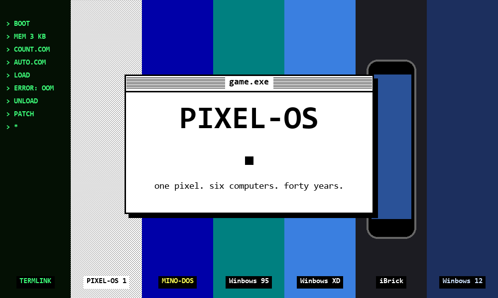

# PIXEL-OS

> Un développeur a fait un pixel en 1984. Il n'a toujours pas fini.
>
> *A developer made one pixel in 1984. He's still not done.*

[Français](#français) · [English](#english)

---

## Français

**PIXEL-OS** est un jeu incrémental (clicker) où tout prend de la mémoire, même l'interface. Ton score, tes couleurs, ton curseur de souris : ce sont des programmes qui occupent de la place. Impossible de tout faire tourner en même temps : tu choisis, tu fermes des fenêtres, tu fais de la place.

Tu commences dans un terminal vert, tu trouves une carte perforée, puis tu traverses six systèmes d'exploitation (sept, si tu recommences), chacun avec son nouveau problème.

### Les époques

| Acte | Système | Nouvelle contrainte |
|---|---|---|
| 0 | Terminal (tutoriel) | La mémoire : charger et décharger des programmes |
| 1 | PIXEL-OS (1984), noir et blanc | La RAM, la défragmentation |
| 2 | MINO-DOS (1990) | Le modem qui grésille, et Maman qui décroche le téléphone |
| 3 | Winbows 95 | Le processeur, l'écran bleu, Bip l'assistant |
| 4 | Winbows XD (2001) | La bande passante, les pop-ups, la messagerie |
| 5 | iBrick (2007), un téléphone | La batterie, les mises à jour forcées, de l'iBrick d'origine jusqu'à la tablette iSlab |
| 6 | Winbows 12 | Les abonnements, et Copixel, une IA qui veut recoder ton ordinateur et finir le jeu à ta place |
| 7 | QUANTUM-OS ∞ (à partir de la Nouvelle partie+) | Tout est incertain : le score ou la vitesse (jamais les deux), un chat dans une boîte, l'écran qui se retourne, des lettres de demain |

### Ce qu'il y a dedans

- Une interface fidèle à chaque époque : fenêtres, menu Démarrer, économiseurs d'écran, icônes.
- Le post-it du développeur, avec une petite tâche à faire à la fois, et des dilemmes qui tombent au hasard.
- Les pixels égarés à attraper, les virus, le piratage de mots de passe façon Fallout, avec un terminal différent à chaque époque.
- Sur le téléphone : gestes façon iOS, applis lancées, écran partagé sur la tablette.
- Plus de 60 succès, la progression hors ligne, une vraie fin et une **Nouvelle partie+** qui double la production à chaque fois (x2, x4, x8…).
- À partir de la 2e Nouvelle partie+, un **arbre de compétences** : 37 compétences en 4 branches (Usine, Doigt, Raccourcis, Chaos), des niveaux, des pierres angulaires et des synergies. Chaque recommencement et chaque acte fini rapportent des points, et l'arbre se réinitialise gratuitement.
- Pour rejouer sans corvée : **automatisation** (achats, matériel, actes suivants, tuto sauté), **paliers** qui doublent la production des programmes, et une **règle différente à chaque partie** à choisir parmi trois.
- À partir de la 10e Nouvelle partie+ : la **couronne « Au-delà »** de l'arbre, et des **règles défi** qui ralentissent la partie contre plus de points.
- **PIXEL-OS 2 : le deuxième pixel**, un nouveau jeu qui s'ouvre avec la toute dernière compétence de l'arbre. On y peint neuf tableaux, un par époque, case par case, en suivant un modèle. Chaque couleur a sa règle (le phosphore aime les lignes, le bleu plante, le gris est une batterie, Copixel peint à ta place, les qubits jouent aux dés), et il y a des bugs à écraser. On peut aller et revenir entre les deux jeux à tout moment.
- Environ 10 heures pour la première partie, en français et en anglais.
- Sauvegarde automatique, plus export et import d'une sauvegarde dans les menus.

### Jouer

Aucune installation ni compilation : c'est du HTML et du JavaScript sans dépendance.

- Ouvre `index.html` dans un navigateur, ou
- lance un petit serveur dans le dossier (`python3 -m http.server`) puis va sur `http://localhost:8000`.

### Les fichiers

| Fichier | Contenu |
|---|---|
| `index.html` | La page, et tout le style de chaque époque |
| `game.js` | Le moteur : ressources, fenêtres, boutique, sauvegarde, succès |
| `data.js` | Les textes communs, le tutoriel et l'acte 1 |
| `era2.js` … `era7.js` | Un fichier par époque : programmes, améliorations, histoire, mécaniques |
| `icons.js` | Les icônes, dessinées dans le style de chaque époque |
| `savers.js` | Les économiseurs d'écran |
| `visuals.js` | Les animations dans les fenêtres des programmes |
| `postit.js` | Le post-it du développeur et les dilemmes |
| `tree.js` | L'arbre de compétences |
| `auto.js` | L'automatisation, les paliers et les règles de partie |
| `p2.js` | PIXEL-OS 2 : le deuxième pixel |

Les textes sont stockés par paires `[anglais, français]` et affichés avec `T()`.

Un jeu de **zuralon**.

---

## English

**PIXEL-OS** is an incremental game where everything uses memory, including the interface. Your score, your colors, even your mouse cursor are programs that take room. You can't run everything at once: you choose, close windows and make room.

Start in a green terminal, find a punched card, then live through six operating systems (seven, if you start again), each with its own new problem.

### The eras

| Act | System | New constraint |
|---|---|---|
| 0 | Terminal (tutorial) | Memory: loading and unloading programs |
| 1 | PIXEL-OS (1984), black and white | RAM, defragmentation |
| 2 | MINO-DOS (1990) | A screeching modem, and Mom picking up the phone |
| 3 | Winbows 95 | The CPU, the blue screen, Bip the assistant |
| 4 | Winbows XD (2001) | Bandwidth, pop-ups, instant messaging |
| 5 | iBrick (2007), a phone | The battery, forced updates, from the first iBrick up to the iSlab tablet |
| 6 | Winbows 12 | Subscriptions, and Copixel, an AI that wants to recode your computer and finish the game for you |
| 7 | QUANTUM-OS ∞ (from New Game+ on) | Nothing is certain: your score or your speed (never both), a cat in a box, an upside-down screen, letters from tomorrow |

### What's inside

- An interface true to each era: windows, Start menus, screensavers, icons.
- The developer's post-it with one small task at a time, and random two-choice events.
- Stray pixels to catch, viruses, Fallout-style password hacking with a different terminal in each era.
- On the phone: iOS-style gestures, running apps, Split View on the tablet.
- More than 60 achievements, offline progress, a real ending and a **New Game+** that doubles production every time (x2, x4, x8…).
- From the second New Game+ on, a **skill tree**: 37 skills in 4 branches (Factory, Finger, Shortcuts, Chaos), with levels, keystones and synergies. Each restart and each finished act gives points, and the tree resets for free.
- To replay without the chores: **automation** (buying, hardware, next acts, skipping the tutorial), **milestones** that double program production, and a **different rule each run**, picked among three.
- From the 10th New Game+ on: the **Beyond crown** of the skill tree, and **challenge rules** that slow the run down for more points.
- **PIXEL-OS 2: the second pixel**, a new game opened by the very last skill of the tree. Paint nine pictures, one per era, cell by cell, following a model. Each colour has its own rule (phosphor loves lines, blue crashes, grey is a battery, Copixel paints for you, qubits roll dice), and there are bugs to squash. You can go back and forth between both games at any time.
- About 10 hours for a first run, in English and French.
- Saves automatically, with save export and import in the menus.

### Play

Nothing to install or build: it's plain HTML and JavaScript with no dependencies.

- Open `index.html` in a browser, or
- run a small server in the folder (`python3 -m http.server`) and go to `http://localhost:8000`.

### Files

| File | What's in it |
|---|---|
| `index.html` | The page, and all the styling for every era |
| `game.js` | The engine: resources, windows, store, saving, achievements |
| `data.js` | Shared texts, the tutorial and act 1 |
| `era2.js` … `era7.js` | One file per era: programs, upgrades, story, mechanics |
| `icons.js` | Icons, drawn in the style of each era |
| `savers.js` | Screensavers |
| `visuals.js` | Animations inside program windows |
| `postit.js` | The developer's post-it and the events |
| `tree.js` | The skill tree |
| `auto.js` | Automation, milestones and run rules |
| `p2.js` | PIXEL-OS 2: the second pixel |

Texts are stored as `[english, french]` pairs and shown with `T()`.

A game by **zuralon**.
